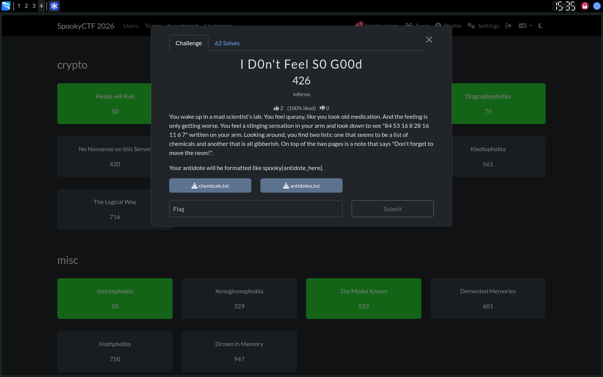
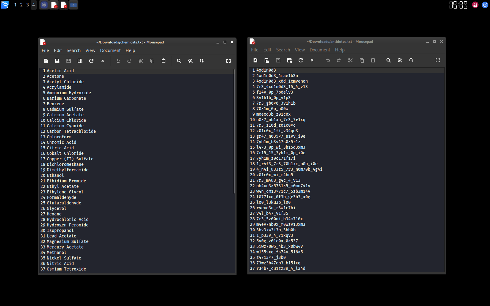
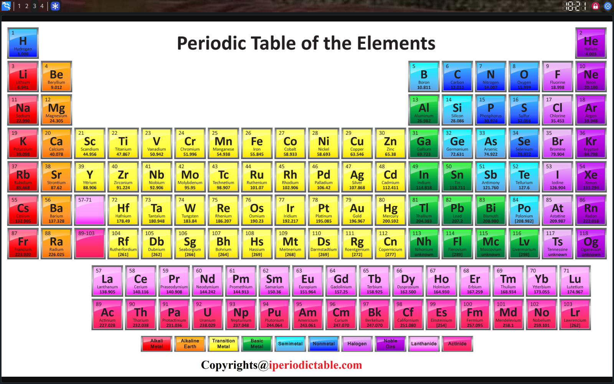
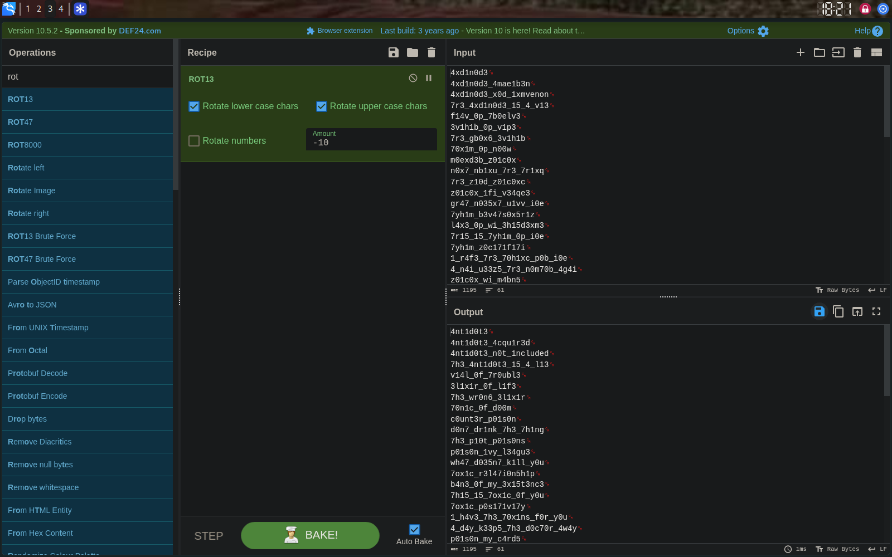

# I D0n't Feel S0 G00d — SpookyCTF 2026

## Challenge

> You wake up in a mad scientist's lab. You feel queasy, like you took old
> medication. And the feeling is only getting worse. You feel a stinging
> sensation in your arm and look down to see "84 53 16 8 28 16 11 6 7"
> written on your arm. Looking around, you find two lists: one that seems to
> be a list of chemicals and another that is all gibberish. On top of the
> two pages is a note that says "Don't forget to move the neon!".

Two files: `chemicals.txt` (60 chemical names) and `antidotes.txt` (61 lines
of leetspeak-looking gibberish). Flag format: `spooky{antidote_here}`.

## Step 1 — the arm numbers

`84 53 16 8 28 16 11 6 7` next to a chemicals list, in a poisoning scenario —
atomic numbers was the obvious read.

| # | Element | Symbol |
|---|---|---|
| 84 | Polonium | Po |
| 53 | Iodine | I |
| 16 | Sulfur | S |
| 8 | Oxygen | O |
| 28 | Nickel | Ni |
| 16 | Sulfur | S |
| 11 | Sodium | Na |
| 6 | Carbon | C |
| 7 | Nitrogen | N |

`Po-I-S-O-Ni-S-Na-C-N` → **"Poison is NaCN"** — Sodium Cyanide.

## Step 2 — "move the neon"

Neon is atomic number 10, so "move the neon" = shift by 10.

I overthought this one for a while — stared at the underscores and digit
patterns in `antidotes.txt` and assumed it had to be some custom
substitution scheme, not a plain Caesar shift, because 426 points felt like
too much for something that simple. Wasted about twenty minutes on that
before just trying the obvious thing.

Ran `antidotes.txt` through CyberChef, ROT13 operation, shift set to -10.

That was it — decoded cleanly into leetspeak. First few lines, matched
against their `chemicals.txt` line numbers:

| # | Chemical | Decoded antidote line |
|---|---|---|
| 1 | Acetic Acid | `4nt1d0t3` |
| 2 | Acetone | `4nt1d0t3_4cquir3d` |
| 3 | Acetyl Chloride | `4nt1d0t3_n0t_1nclud3d` |
| 4 | Acrylamide | `7h3_4nt1d0t3_15_4_l13` |

## Result

Sodium Cyanide was entry 52 in `chemicals.txt`, matched to the corresponding
line in the decoded antidotes list, wrapped in the flag format.

`spooky{xxxxxxxxxxxxxx}` → flag submitted.

## Notes

- Hint text ("move the neon") was literal, not metaphorical — worth trying
  the simplest cipher a hint implies before assuming something custom.
