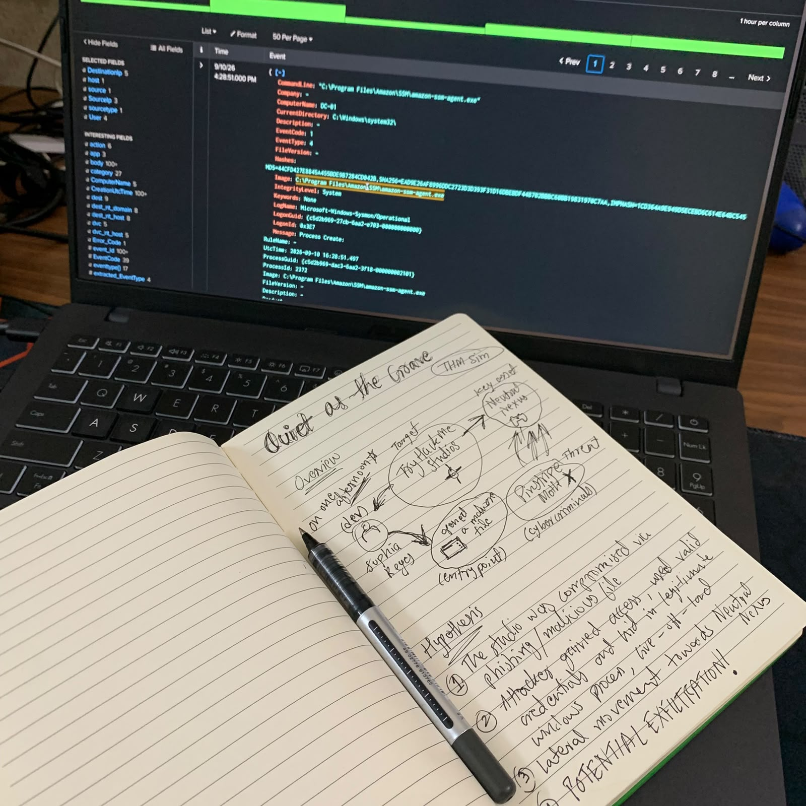
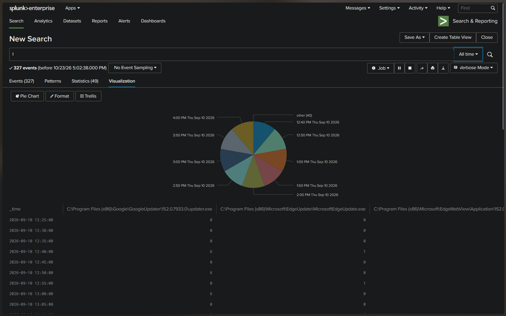
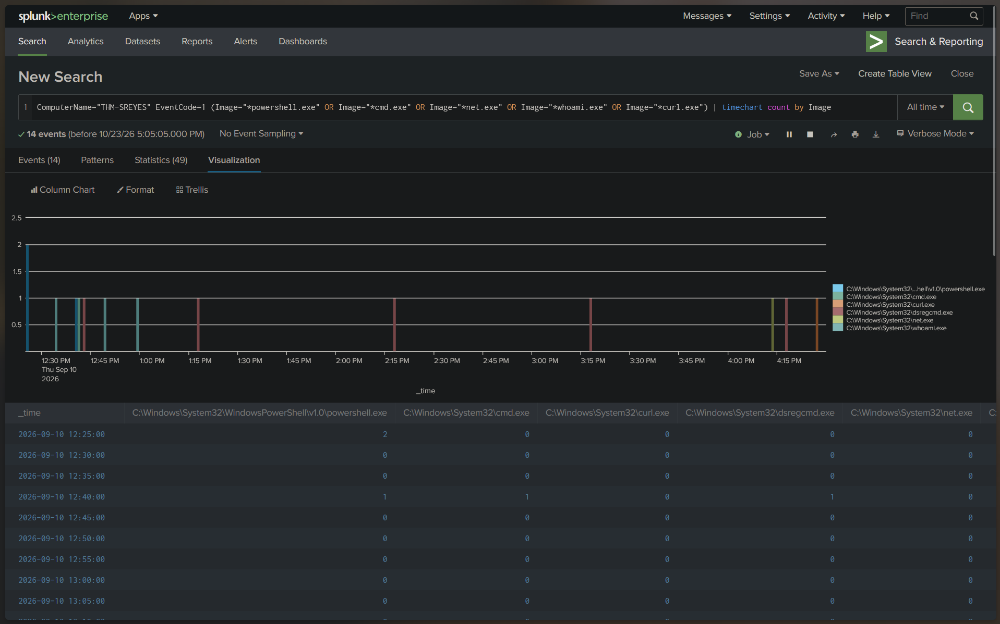
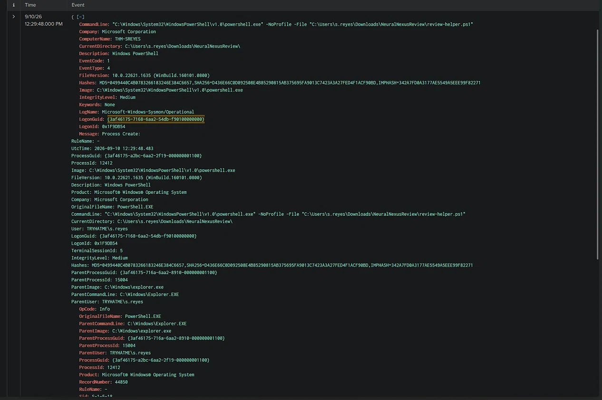
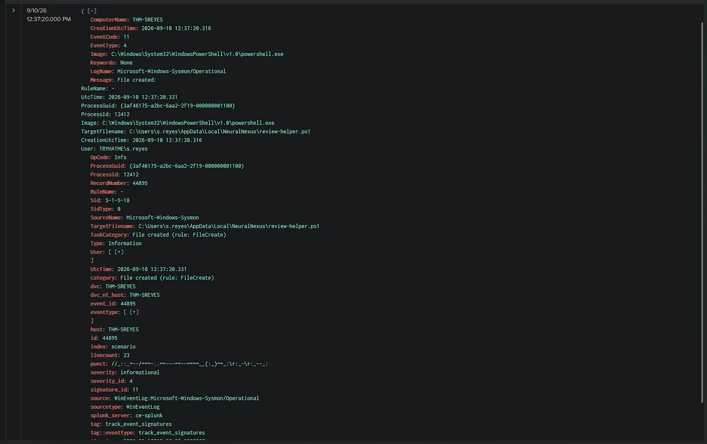
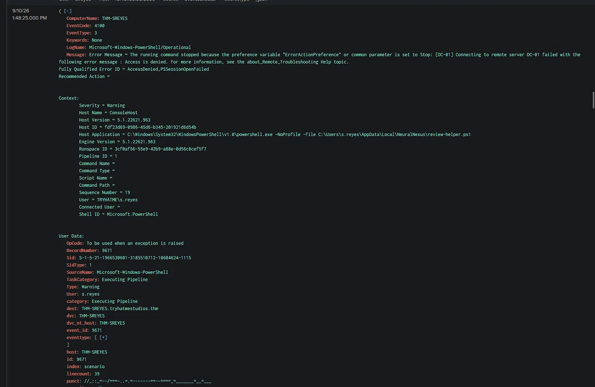
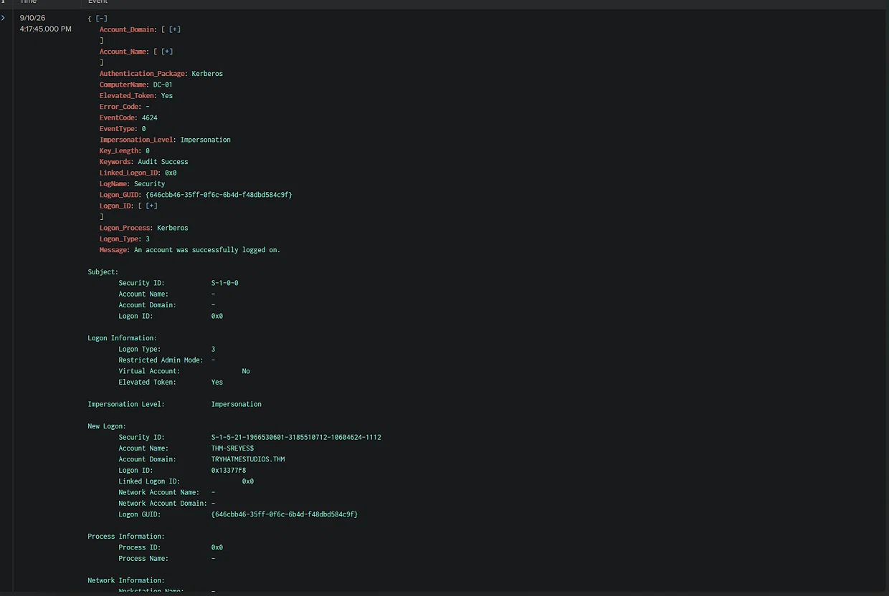

# Threat Hunt: "Quiet as the Grave"

Hypothesis-driven threat hunt in Splunk, reconstructing an intrusion at a fictional game studio from Sysmon, Windows Security and PowerShell logs.

| | |
|---|---|
| **Platform** | TryHackMe Threat Hunting Simulator |
| **Tools** | Splunk Enterprise, Sysmon, Windows event logs |
| **Target** | TryHatMe Studios (key asset: *NeuralNexus*) |
| **Threat actor** | Pinstripe Moth (financially motivated) |
| **Verdict** | Hypothesis supported |

**Contents:** [Abstract](#abstract) · [Theory](#theory) · [Scenario](#scenario-and-hypotheses) · [Methodology](#methodology) · [Findings](#findings) · [IOCs](#indicators-of-compromise) · [Discussion](#discussion) · [Limitations](#limitations) · [Recommendations](#recommendations) · [Conclusion](#conclusion) · [References](#references)

---

# ▸ Abstract

A developer workstation (`THM-SREYES`) was suspected of compromise through a malicious archive. By baselining normal activity and then isolating attacker-relevant binaries, I reduced 8,673 events to 14 and rebuilt the chain: a user-executed PowerShell script, staging in `AppData`, discovery with built-in tools, a denied remote session, a Kerberos network logon to the domain controller as the machine account, and compression of data ahead of exfiltration.

# ▸ Theory

### Threat hunting vs. alert triage
Triage reacts to alerts. Hunting is proactive: start from a **hypothesis** about attacker behavior, search the data for evidence, then confirm or reject it. A hunt can succeed even with zero alerts, which suits this scenario ("quiet as the grave").

### Hunt loop used
1. **Hypothesis**: what would the attacker have done?
2. **Data**: which logs would show it?
3. **Search and pivot**: query, find an anomaly, follow its links.
4. **Conclude**: map to ATT&CK, record IOCs, recommend fixes.

### Living off the land (LotL)
Attackers use tools already on the system (`powershell.exe`, `whoami.exe`, `net.exe`, `curl.exe`) so there is no malware binary to flag. The tools are legitimate; the **context** is not. Parent process, user, path and timing are the detection signal.

### Log sources and why they matter

| Source | Event ID | Meaning | Used for |
|---|---|---|---|
| Sysmon | 1 | Process creation (command line, parent, hashes) | Execution, discovery |
| Sysmon | 11 | File created | Staging |
| Security | 4624 | Successful logon (type, account, source IP) | Lateral movement |
| Security | 4769 | Kerberos service ticket requested | Logon baseline |
| PowerShell | 4100 | Pipeline error | Failed remote session |
| PowerShell | 4103 | Pipeline/module execution | Collection |

### Logon type 3 and machine accounts
Logon Type 3 is a **network logon** (remote access to a resource). Machine accounts (names ending in `$`) authenticate to domain controllers constantly for normal operations, so such a logon is only suspicious in context: what ran just before it, and whether it carries an elevated token.

# ▸ Scenario and hypotheses

Developer Sophia Reyes (`s.reyes`) opened a malicious file, the likely entry point. My hypotheses:

1. The studio was compromised via phishing or a malicious file.
2. The attacker used valid credentials and hid in legitimate Windows processes.
3. Lateral movement followed, towards NeuralNexus.
4. Data was potentially exfiltrated.



# ▸ Methodology

## 1. Baseline
First search (`*`) over all time to see what normal looks like: 8,673 events, dominated by routine processes such as the AWS SSM agent on `DC-01` and browser updaters (Google and Edge update). Grouping process images over time showed these repeat on a fixed schedule, so they could be ruled out.



## 2. Isolate attacker-relevant activity
Narrowed to the suspect host and to binaries commonly abused for LotL:

```spl
ComputerName="THM-SREYES" EventCode=1
(Image="*powershell.exe" OR Image="*cmd.exe" OR Image="*net.exe" OR Image="*whoami.exe" OR Image="*curl.exe")
| timechart count by Image
```

14 events, in distinct bursts, instead of thousands.



## 3. Pivot by lineage
For each hit I read `ParentCommandLine`, `User`, `LogonId` and timestamp. Every discovery and collection event had the same parent: PowerShell running `review-helper.ps1`. That one lineage tied the whole chain together.

## 4. Confirm on the domain controller
Checked `DC-01` Security events around the timestamps of interest for network logons and Kerberos activity.

Illustrative pivots (field names as they appear in this index):

```spl
EventCode=1 ParentCommandLine="*NeuralNexus\\review-helper.ps1*"
| table _time Image CommandLine User

EventCode=11 TargetFilename="*NeuralNexus*"
| table _time Image TargetFilename

ComputerName="DC-01" EventCode=4624 Logon_Type=3
| table _time Account_Name Source_Network_Address Elevated_Token
```

# ▸ Findings

| Time | Stage | ATT&CK | Evidence |
|---|---|---|---|
| 12:29:48 | Script run from `Downloads\NeuralNexusReview`, parent `explorer.exe` | T1204.002 User Execution | Sysmon 1 |
| 12:37:20 | Script copied to `AppData\Local\NeuralNexus\` | Staging | Sysmon 11 |
| 12:46:41 | `whoami.exe` | T1033 System Owner Discovery | Sysmon 1 |
| 13:48:25 | Remote PowerShell session to `DC-01` denied | T1021.006 (failed) | PowerShell 4100 |
| 16:12:14 | `net.exe user /domain` | T1087.002 Domain Account Discovery | Sysmon 1 |
| 16:17:45 | Network logon to `DC-01` as `THM-SREYES$` | T1021 | Security 4624 |
| 16:27:29 | Compression library loaded | T1560 Archive Collected Data | PowerShell 4103 |
| After 16:27 | Archive sent to C2 over HTTPS (8443) | T1041 | Pending evidence |

**Execution.** The user ran the script from `Downloads`; `explorer.exe` as parent means an interactive launch.



**Staging.** Eight minutes later the script copied itself into the user profile. Every later action descends from this copy.



**Failed escalation.** The script tried to open a remote session to the domain controller as `s.reyes` and was denied (`AccessDenied, PSSessionOpenFailed`).



**Machine account logon.** After domain discovery, `DC-01` recorded a Kerberos network logon for `THM-SREYES$` from `10.60.10.20` with an elevated token, after the user account had been refused.



# ▸ Indicators of Compromise

| Type | Indicator |
|---|---|
| Script | `review-helper.ps1` |
| Initial path | `C:\Users\s.reyes\Downloads\NeuralNexusReview\` |
| Staging path | `C:\Users\s.reyes\AppData\Local\NeuralNexus\` |
| User | `s.reyes@TRYHATMESTUDIOS.THM` |
| Host | `THM-SREYES` (`10.60.10.20`) |
| Machine account | `THM-SREYES$` |
| Archive | `review-cache.zip` |
| C2 | `45.147.230.131:8443` |

# ▸ Discussion

- **Lineage beats signatures.** No malicious binary was involved; one parent process linked every step.
- **Baseline first.** Knowing the updater and SSM-agent noise made the 14 relevant events stand out.
- **Credential fallback.** When the user context was denied, the machine account succeeded. Monitoring machine-account logons to DCs, combined with preceding failures, is a useful detection.

# ▸ Limitations

- No Run key or scheduled task was confirmed, so the `AppData` copy is treated as staging, not proven persistence.
- The archive download, the `curl.exe` exfiltration event and the C2 connection are not yet documented with screenshots; the C2 indicators come from my hunt notes.
- `cmd.exe` and `dsregcmd.exe` activity near 12:40 was seen in the chart but not analysed.
- Simulated dataset; real environments are noisier.

# ▸ Recommendations

1. Isolate `THM-SREYES`; block `45.147.230.131`.
2. Reset `s.reyes` credentials and revoke the machine account's Kerberos tickets.
3. Remove `AppData\Local\NeuralNexus\` and hunt the script across the estate.
4. Detect `powershell.exe -File` launched from `AppData` or `Downloads`.
5. Alert on machine-account network logons to DCs that follow failed remote sessions from the same host.

# ▸ Conclusion

The evidence supports the hypothesis. A user-executed script was staged in `AppData`, used native tools for discovery, was denied remote access, then authenticated to the domain controller as the machine account and prepared data for exfiltration.

**Future work:** write Sigma/Splunk detections for these behaviors; add the exfiltration evidence; map the chain in ATT&CK Navigator.

# ▸ References

- TryHackMe Threat Hunting Simulator
- [MITRE ATT&CK](https://attack.mitre.org/): T1204.002, T1033, T1021, T1087.002, T1560, T1041
- Microsoft docs: Security events 4624, 4769; Sysmon events 1, 11
